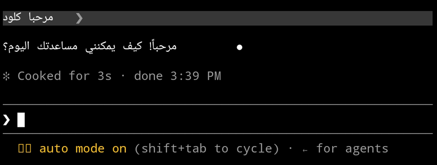
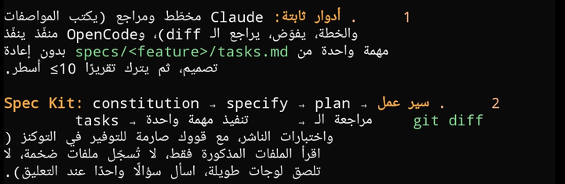
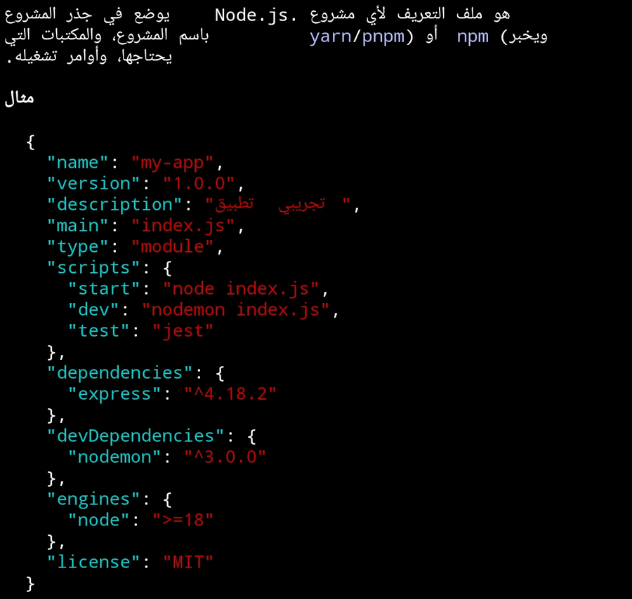

<div align="center">

# AR Termux

**Termux with proper Arabic (and Hebrew / Persian / Urdu) — connected letters, right direction, no reversed text.**

**ترمكس بدعم عربي صحيح: حروف متصلة، واتجاه صحيح، من غير انعكاس أو تقطيع.**

[](https://github.com/ahmedsykoo/ar-termux/actions/workflows/build.yml)
[](LICENSE)
[](https://github.com/ahmedsykoo/ar-termux/releases)

[العربية](#العربية) · [English](#english)

</div>

<div align="center">

 



<sub>Claude Code and OpenCode running inside AR Termux (Android 14). Arabic is connected and reads right-to-left; code stays left-to-right.<br>Screenshots are from a real device — see <a href="docs/LIMITATIONS.md">known limitations</a>.</sub>

</div>

---

## العربية

### المشكلة
Termux (وأغلب الترمينالات) بيرسم كل حرف في خانة لوحده، فالعربي بيطلع **حروف مقطعة** و**جمل معكوسة**.

### الحل
AR Termux هو **Termux الأصلي بكل خصائصه** (`pkg`, الإضافات، كل الأدوات) مع تعديل واحد في طريقة رسم النص:
- الكلمات العربية بتتشكل وتتوصل (مش حرف في كل خانة).
- السطور اللي بتبدأ بعربي بتترتب **من اليمين لليسار**، والكلمات الإنجليزية والأرقام جواها بتفضل في مكانها الصح.
- علامات الترقيم بين العربي والإنجليزي بتتبع الاتجاه العربي.
- الجداول والإطارات (`│ ╭ ─`) بتفضل منتظمة.
- شغّال مع أدوات الذكاء الاصطناعي في الترمينال زي **Claude Code** و**OpenCode** (شوف [الدليل](docs/CLAUDE-CODE-ON-ANDROID.md)).

### التثبيت
1. نزّل آخر APK من [Releases](https://github.com/ahmedsykoo/ar-termux/releases). لأغلب الموبايلات الملف المناسب هو `arm64-v8a`.
2. ⚠️ **لازم تمسح Termux الأصلي وكل إضافاته (Termux:API وTermux:Boot ...) الأول.** AR Termux بيحل محله لأن حزم Termux كلها مبنية على اسم التطبيق `com.termux`، ومينفعش يتثبت جنبه. خد نسخة من ملفاتك قبل المسح:
   ```bash
   termux-setup-storage && cp -r ~ ~/storage/shared/termux-backup
   ```
3. ثبّت الـ APK (وافق على "مصادر غير معروفة")، وافتح التطبيق.
4. جرّب:
   ```bash
   echo "مرحبا بالعالم"
   echo "اشرحلي ملف package.json من فضلك"
   ```

لو التثبيت فشل برسالة `conflicts with an existing package`، راجع [حل المشاكل](docs/TROUBLESHOOTING.md).

### الحالة
**Beta.** اتجرّب على موبايل واحد (Android 14) مع bash وClaude Code وOpenCode. مرحبًا بتقاريرك على موبايلات تانية. شوف [القيود المعروفة](docs/LIMITATIONS.md).

### المساهمة
أي تعديل بيتفتح كـ Issue أو Pull Request، و**الفريق بيراجع ويقرر** يقبل ولا لأ، ومحدش بينشر إصدار غير الفريق. الإصدارات الرسمية هي اللي في [Releases](https://github.com/ahmedsykoo/ar-termux/releases) بس. التفاصيل في [GOVERNANCE.md](GOVERNANCE.md).

---

## English

Termux (like most terminals) draws one glyph per cell, so Arabic comes out as **disconnected letters** and **reversed sentences**.

**AR Termux is Termux itself** — all packages, `pkg`, add-ons — plus one change to how text is drawn:

- RTL words are drawn as shaped runs → **connected letters**.
- Rows that start with RTL text are laid out **right-to-left**; Latin words, numbers and code inside keep their natural order.
- Spaces/punctuation between RTL and LTR text follow the RTL base direction.
- Tables / box-drawing rows keep their column layout.
- Works with terminal AI tools such as **Claude Code** and **OpenCode** ([guide](docs/CLAUDE-CODE-ON-ANDROID.md)).

### Install
1. Download the latest APK from [Releases](https://github.com/ahmedsykoo/ar-termux/releases) (`arm64-v8a` for most phones) and verify `SHA256SUMS.txt`.
2. **Uninstall the original Termux and all its add-ons first.** AR Termux keeps the package name `com.termux` (Termux packages are built for `/data/data/com.termux/files/usr`), so it replaces Termux and can't be installed beside it. Back up `~` first.
3. Install the APK and open it.

### Status
**Beta.** Tested on one device (Android 14) with bash, Claude Code and OpenCode. See [limitations](docs/LIMITATIONS.md).

### How it works
We don't fork Termux. [`patches/`](patches) is applied to the exact upstream commit in [`BASE_COMMIT`](BASE_COMMIT) and CI builds the APKs. Details: [docs/ARCHITECTURE.md](docs/ARCHITECTURE.md).

### Build it yourself
```bash
scripts/test.sh     # layout unit tests (JDK only)
scripts/build.sh    # clone Termux @ BASE_COMMIT, apply patches, build (JDK 17 + Android SDK/NDK)
```

### Contributing · Governance · Security · License
[CONTRIBUTING.md](CONTRIBUTING.md) · [GOVERNANCE.md](GOVERNANCE.md) (maintainers approve every change; only Releases here are official) · [SECURITY.md](SECURITY.md) (read the note about the signing key) · [GPL-3.0](LICENSE).
AR Termux is based on [termux/termux-app](https://github.com/termux/termux-app) (GPLv3 with Apache-2.0 parts from
[Terminal Emulator for Android](https://github.com/jackpal/Android-Terminal-Emulator)). It is an unofficial fork and is
not affiliated with or endorsed by the Termux project.

If it helps you, a ⭐ makes it easier for other Arabic-speaking developers to find.
